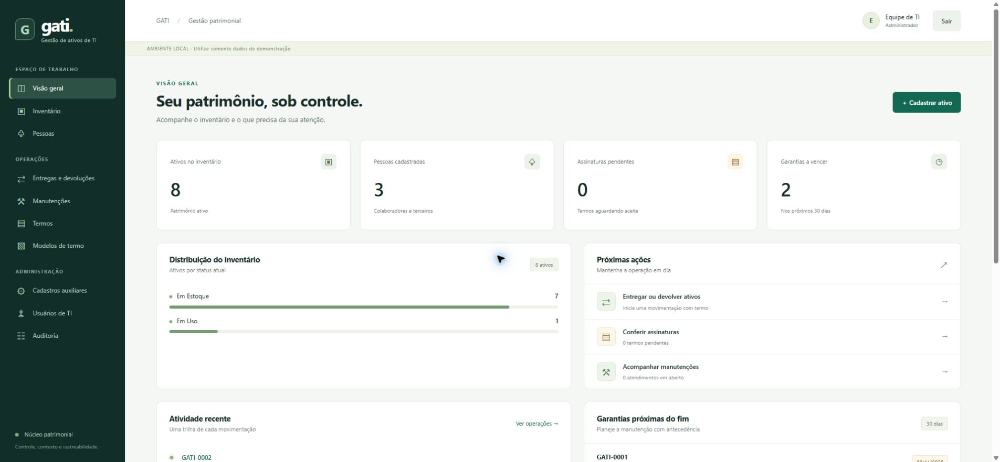
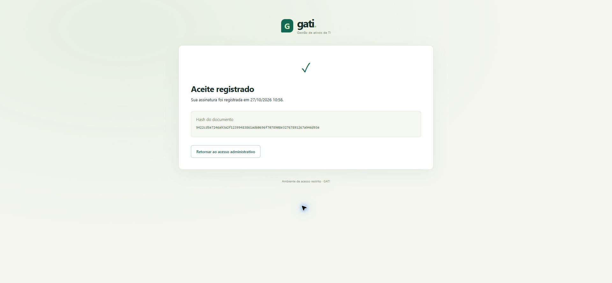

# Validação da entrega — 27/10/2026

Ambiente local Windows, Python 3.14.7, Django 5.2.18, PostgreSQL 18.6 e ClamAV 1.4.6 LTS com bases oficiais atualizadas por FreshClam. Todos os dados de teste são sintéticos.

| Verificação | Resultado |
|---|---|
| Suíte completa com ClamAV real habilitado | 67 testes aprovados; zero falhas, erros ou ignorados; 37.26 s |
| Cobertura Python de linhas | 87.97% — mínimo 80% |
| Cobertura de ramificações | 72.58% — mínimo 70% |
| Ruff: análise estática e formatação | Aprovadas |
| Django system check | Sem problemas |
| Django check --deploy com configuração HTTPS de teste | Sem problemas |
| Migrations pendentes | Nenhuma; inicialização aplicada em PostgreSQL 18 real |
| OpenAPI 3.1 | Gerado e validado sem avisos |
| Iniciador local preparado | Verificação de configuração, PostgreSQL e ClamAV aprovada |

A cobertura inclui `gati`, exceto migrations, comandos administrativos e declaração de apps, conforme `pyproject.toml`. Integridade das migrations é verificada nos testes PostgreSQL, inclusive tentativas de alteração por SQL. O comando de expiração recebeu uma checagem adicional após o ajuste de concorrência: teste específico aprovado, preservando exclusão de arquivos somente após commit. Os gatilhos não protegem contra um administrador de banco capaz de desativá-los; produção requer separação de privilégios.

## Fluxos validados

- Cadastro e edição patrimonial, versões concorrentes, duplicidade, inativação e histórico aditivo.
- Matriz de acesso, campos permitidos da API, mascaramento, CSRF, sessões, bloqueio de login e limitação de recuperação de senha.
- Entrega, devolução, avaria, testemunhas e responsabilidades compartilhadas.
- Termos congelados, edição de rascunho, cancelamento, substituição sem repetição de movimento e evidências imutáveis.
- Convites consumidos/expirados, reemissão, cinco falhas de identidade e aceite idempotente. Duas conexões PostgreSQL submeteram o mesmo aceite simultaneamente sem duplicar vínculo ou histórico.
- Importação CSV/XLSX, fórmulas, macros, duplicidade, referências e conflito após prévia, com rollback integral.
- Upload privado, MIME/extensão, integridade de download, falhas do scanner e respostas de infecção controladas.
- **ClamAV real:** PNG sintético anexado, baixado e comparado byte a byte; CSV sintético importado com prévia e confirmação. O teste de resposta de infecção usa simulação do protocolo, sem introduzir malware no computador.

## Verificação no navegador

Chrome local: login, pesquisa HTMX, inventário, wizard completo de sete etapas, termo emitido, início presencial com logout, confirmação dos quatro últimos dígitos fictícios, aceite, retorno administrativo e conferência do ativo Em Uso com responsabilidade aberta e histórico. Capturas mostram somente dados de demonstração.

Painel conferido em desktop e viewport de tablet 768 × 1024, sem transbordamento horizontal do documento; menu abre e fecha por Escape. O tamanho normal da janela foi restaurado. A revisão corrigiu a política de referência que inicialmente impedia formulários, o alvo HTMX da pesquisa e a navegação por teclado do menu.

## Limites da evidência

Não houve publicação, provisionamento Hostinger, execução de GitHub Actions, Docker nesta máquina, teste SMTP contra serviço externo, auditoria completa ASVS/ZAP, teste de carga representativo do RNF-009 ou recuperação de backup produtivo. São atividades de homologação/infraestrutura identificadas em `OPERACAO.md`. O teste local comprova os fluxos e invariantes exercitados, não disponibilidade ou capacidade de uma infraestrutura ainda não configurada.

O código está acompanhado do esquema OpenAPI e de evidência estruturada em `evidencias/validacao.json` e `evidencias/testes.xml`. O pacote portátil exclui `.env`, banco, anexos, e-mails, credenciais de demonstração, ambientes Python e caches.
